# Проверка лабораторной работы №14

Парфёнок Иван, группа 477, вариант 17.

Снимки ниже показывают HTML-протоколы реальных запусков программ и HTTP-тестов. Это представление сохраненного stdout/stderr, а не снимки окна терминала. Полные журналы доступны рядом в TXT.

## task1

[Полный журнал](task1.txt)

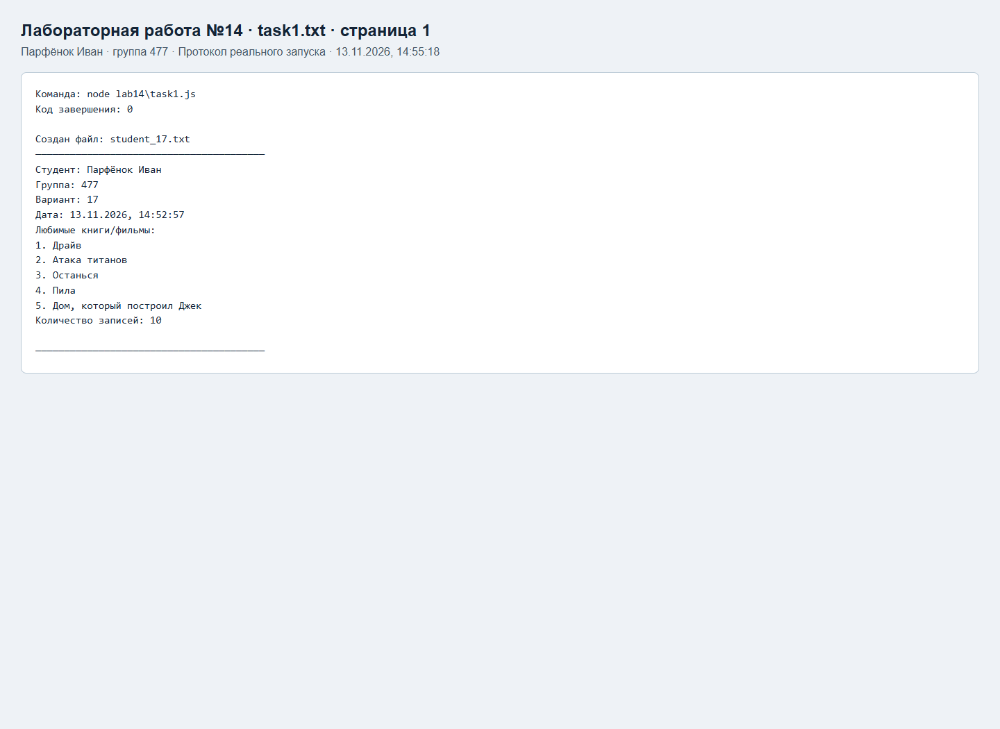

## task2

[Полный журнал](task2.txt)

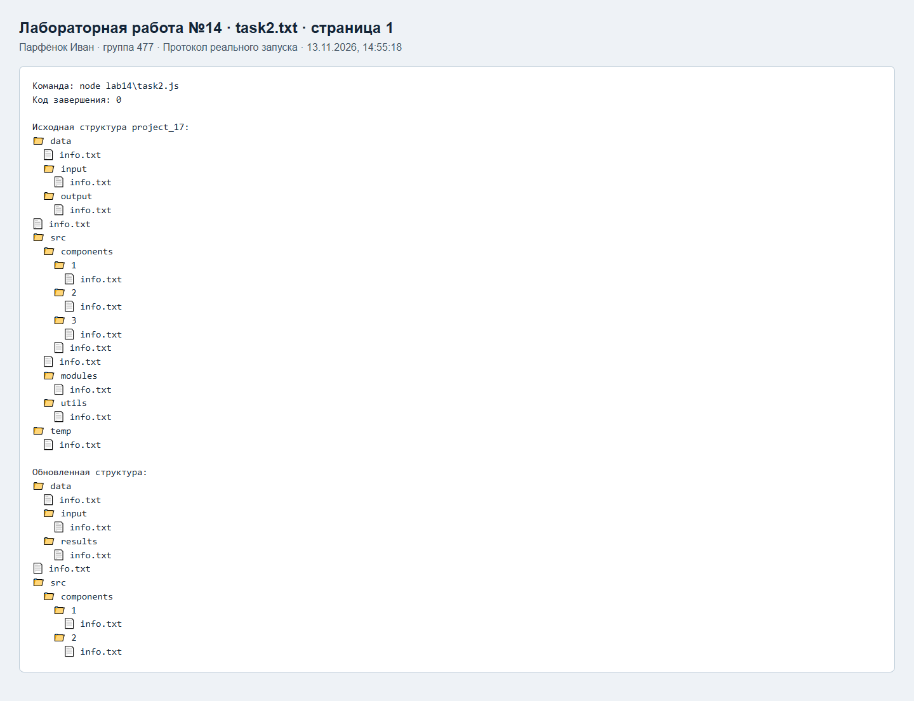

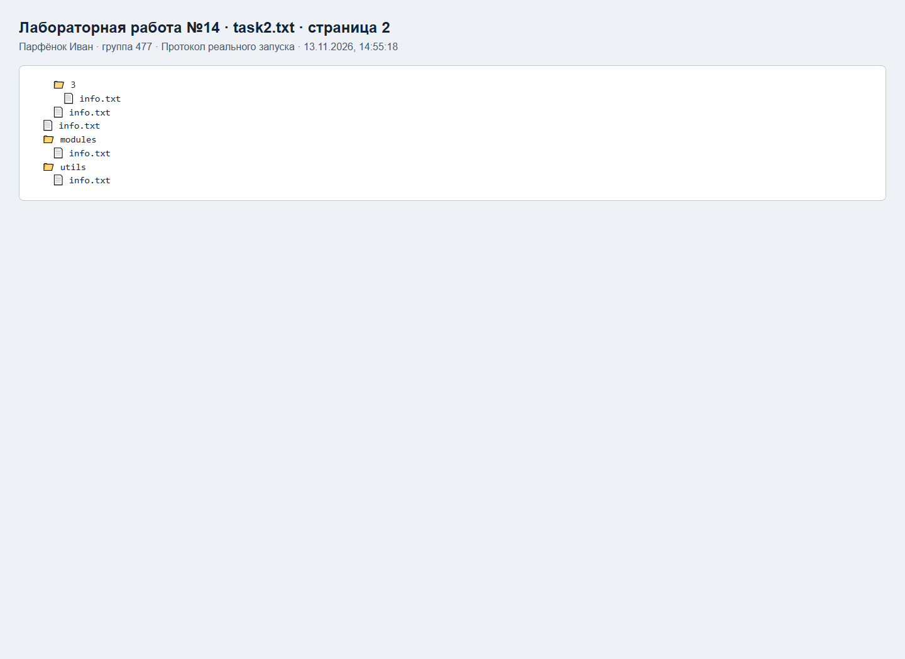

## task3

[Полный журнал](task3.txt)

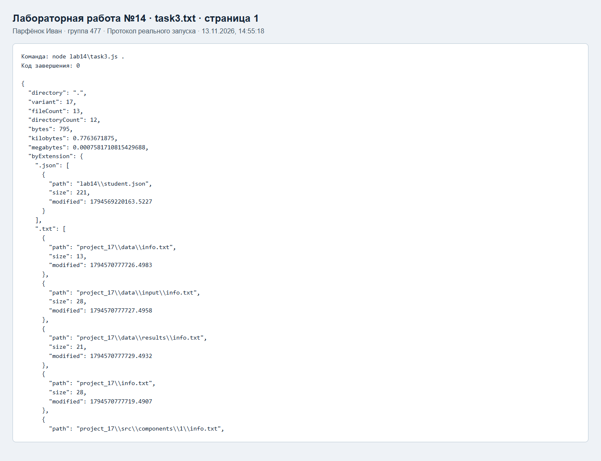

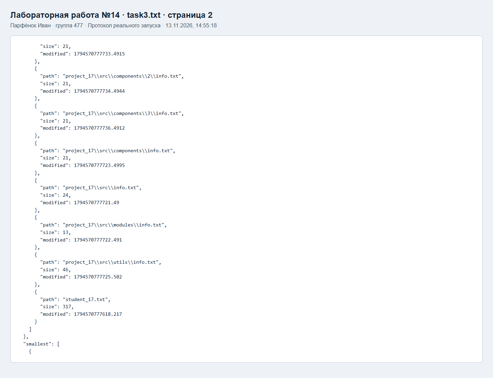

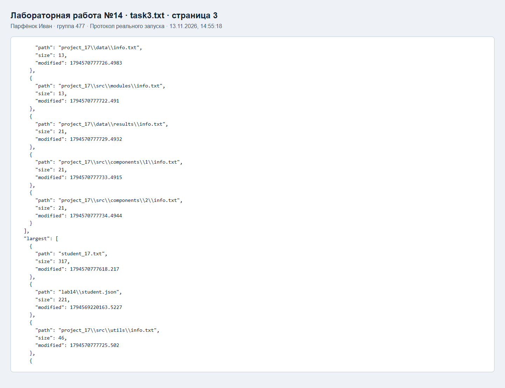

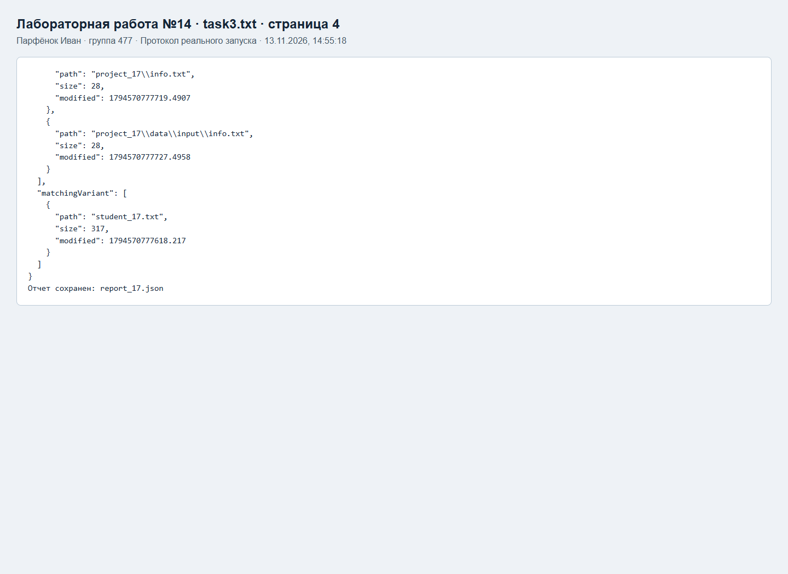

## task4

[Полный журнал](task4.txt)

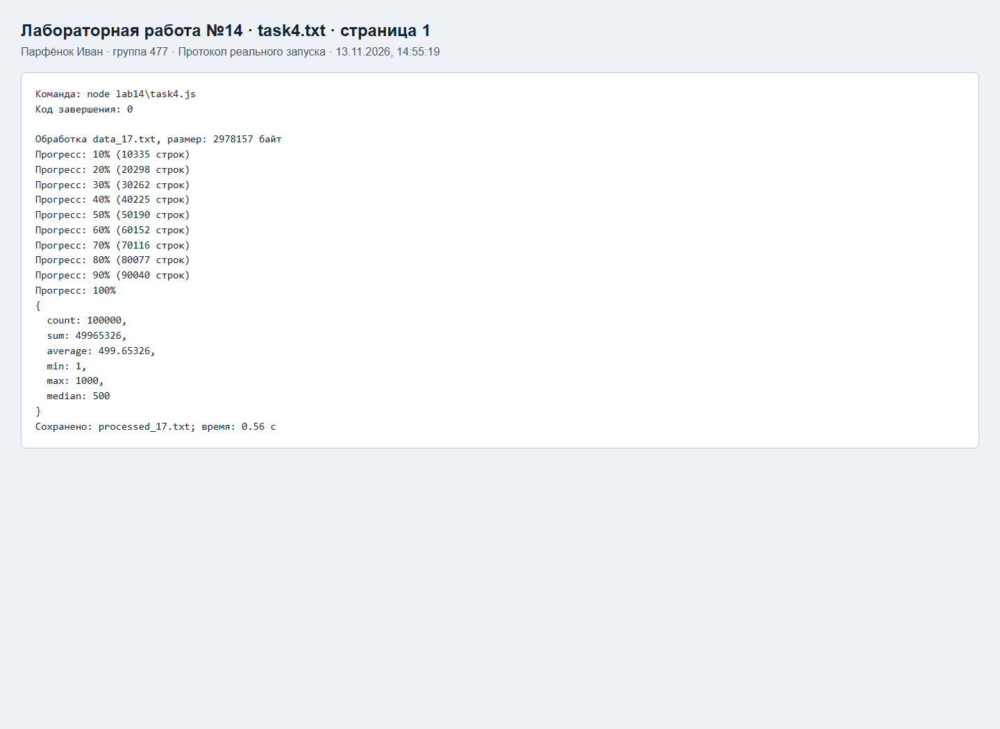

## task5

[Полный журнал](task5.txt)

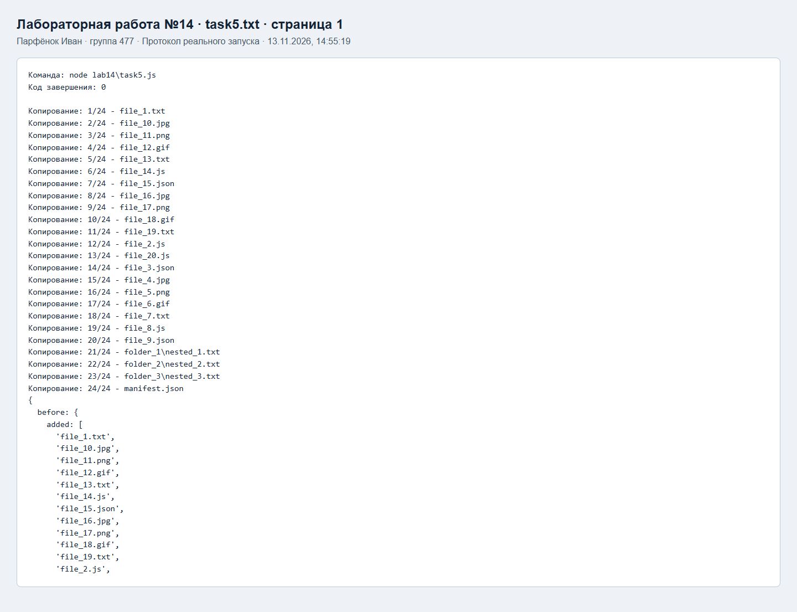

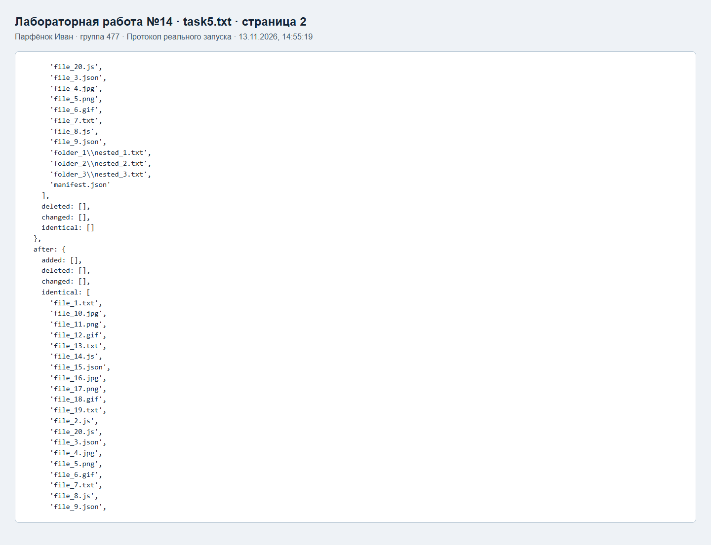

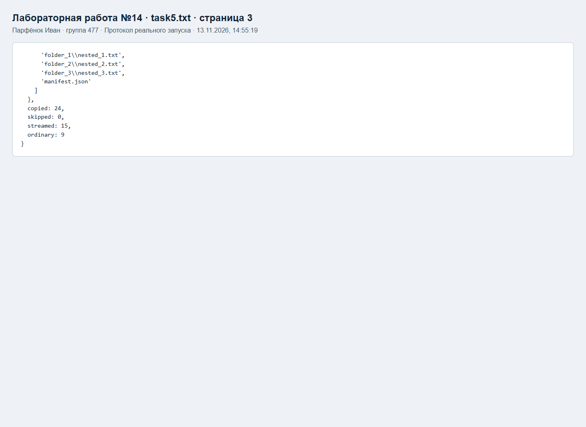

