# Проверка лабораторной работы №17

Парфёнок Иван, группа 477, вариант 17.

Снимки ниже показывают HTML-протоколы реальных запусков программ и HTTP-тестов. Это представление сохраненного stdout/stderr, а не снимки окна терминала. Полные журналы доступны рядом в TXT.

## task1-error

[Полный журнал](task1-error.txt)

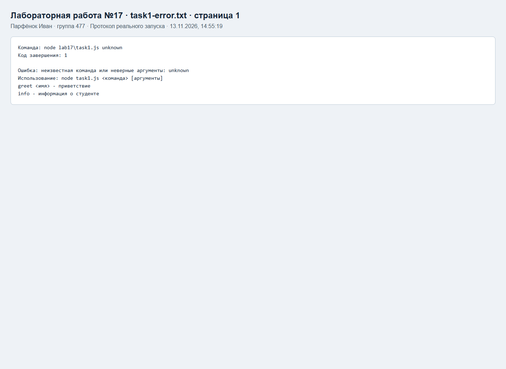

## task1-greet

[Полный журнал](task1-greet.txt)

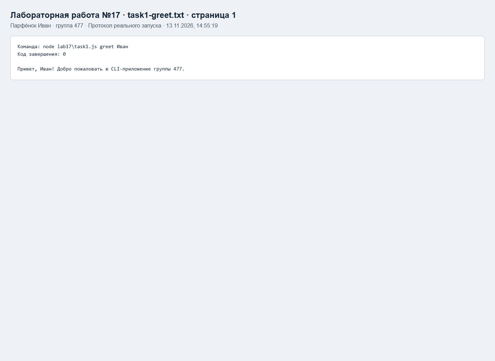

## task1-help

[Полный журнал](task1-help.txt)

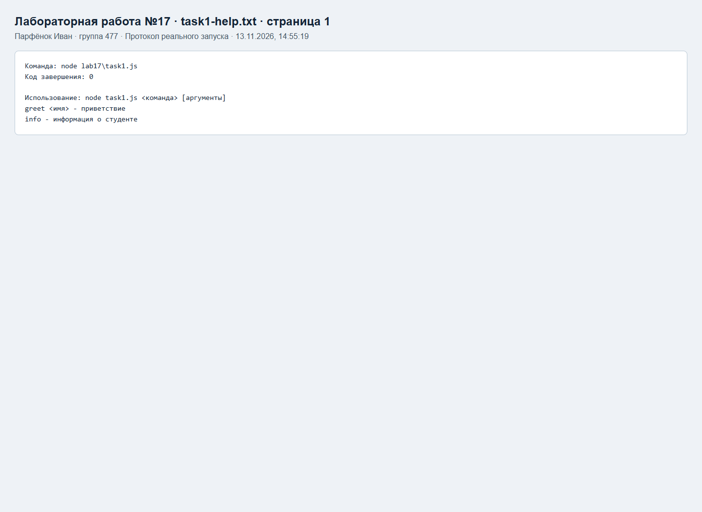

## task1-info

[Полный журнал](task1-info.txt)

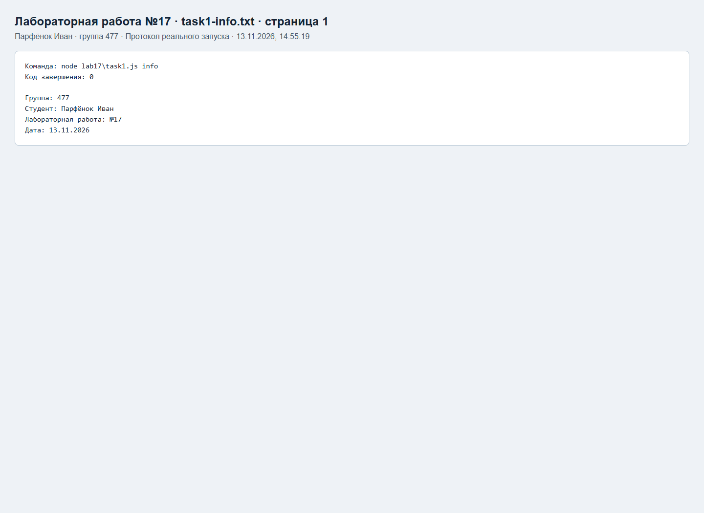

## task2-dry-run

[Полный журнал](task2-dry-run.txt)

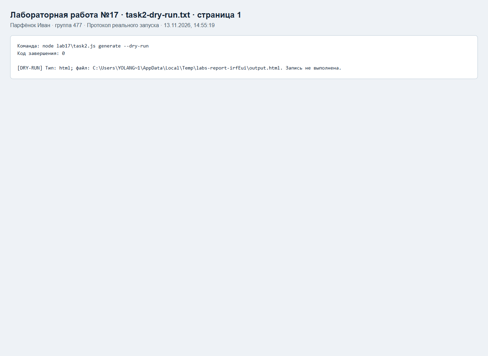

## task2-error

[Полный журнал](task2-error.txt)

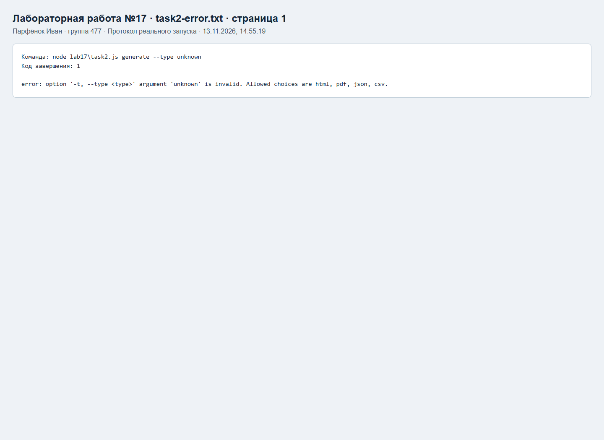

## task2-generate

[Полный журнал](task2-generate.txt)

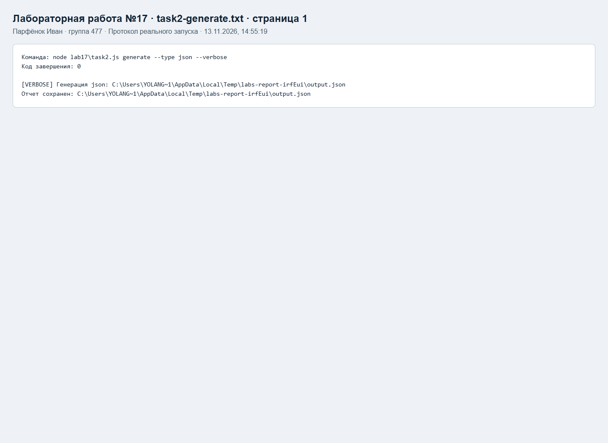

## task2-help

[Полный журнал](task2-help.txt)

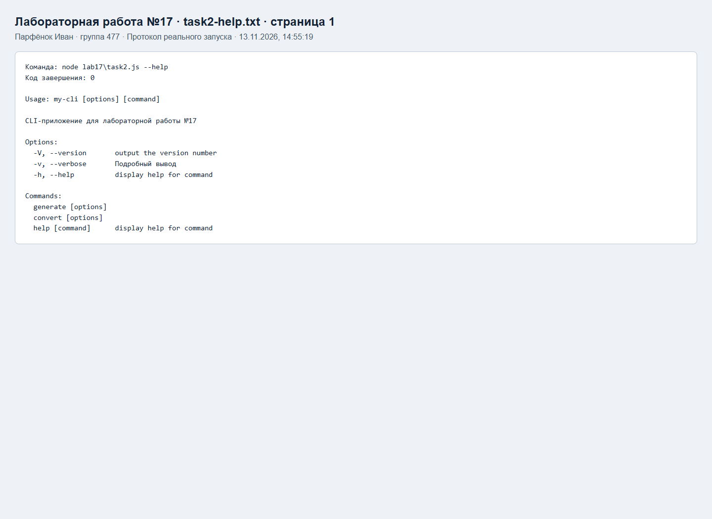

## task3-error

[Полный журнал](task3-error.txt)

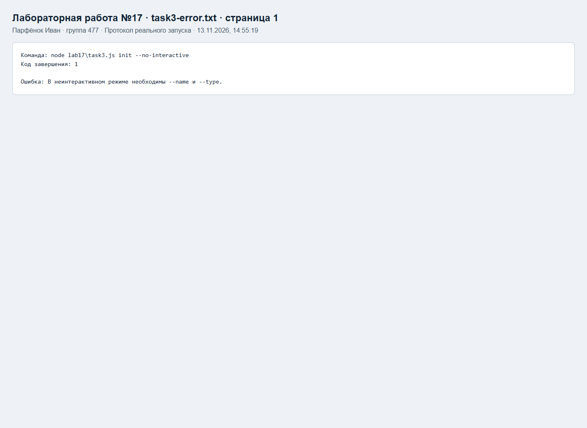

## task3-flags

[Полный журнал](task3-flags.txt)

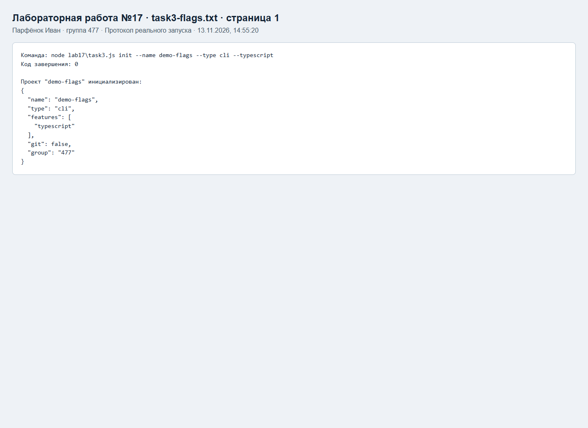

## task3-stdin

[Полный журнал](task3-stdin.txt)

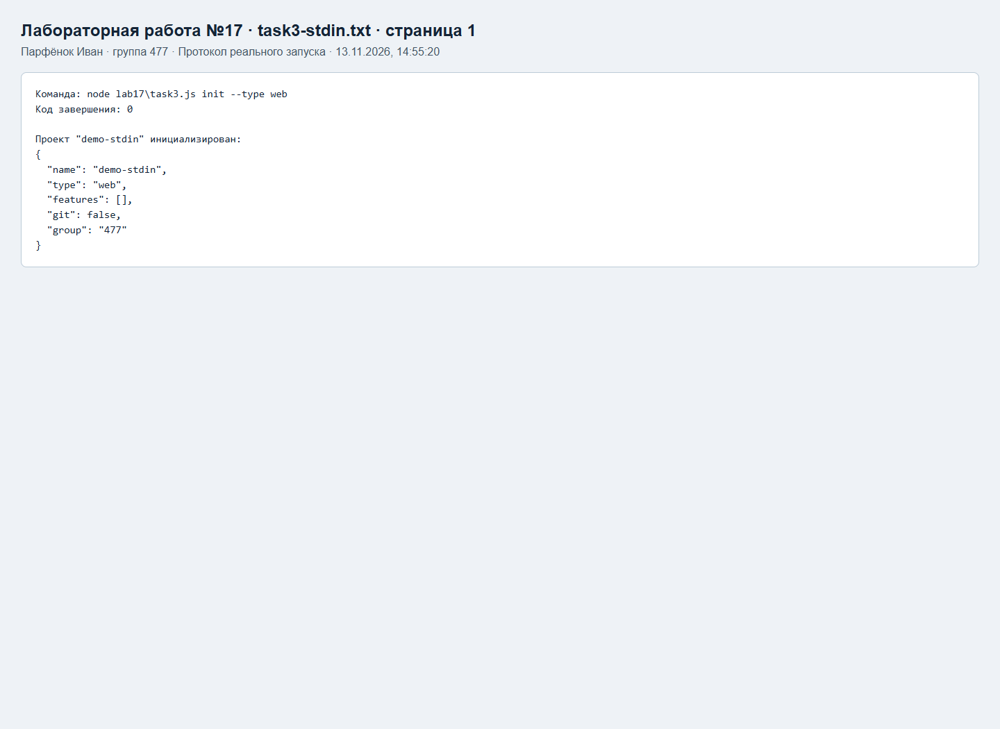

## tests

[Полный журнал](tests.txt)

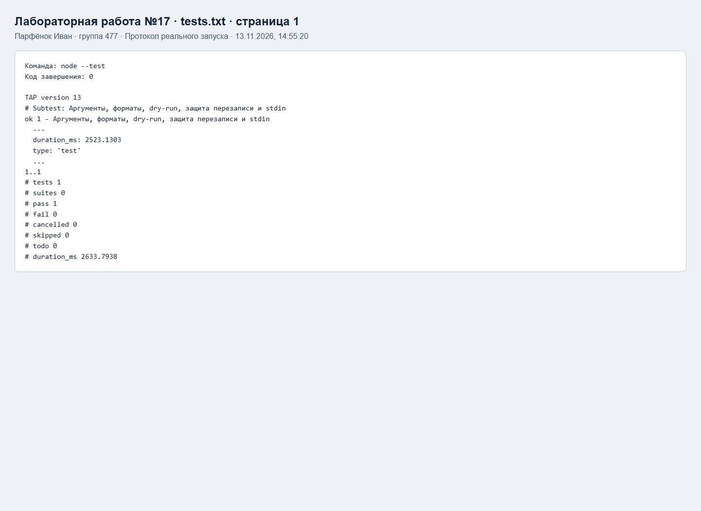

Интерактивный режим дополнительно проверен в PTY: имя demo-interactive, тип web, checkbox typescript, confirm No и password с маской. Создан project.json; учебный токен в файл не записывается.
