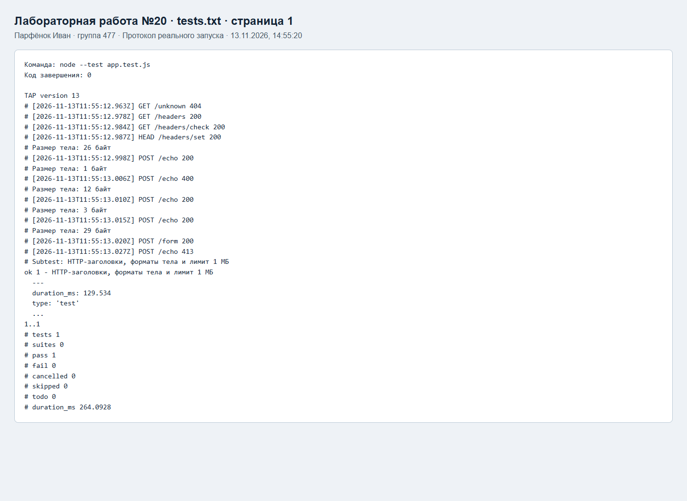
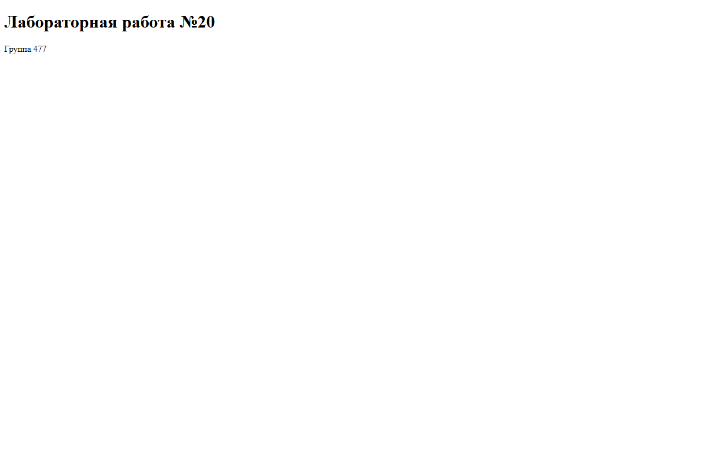
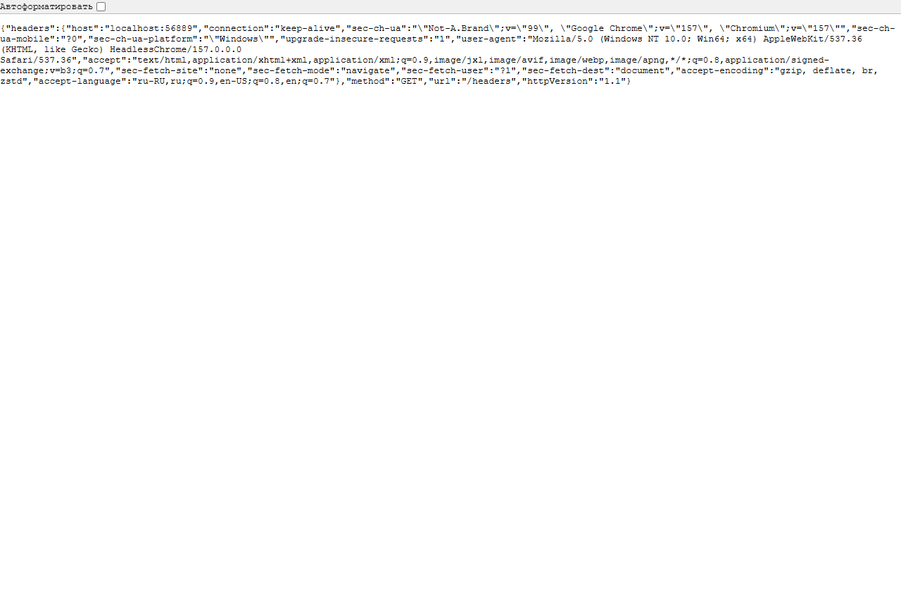

# Проверка лабораторной работы №20

Парфёнок Иван, группа 477, вариант 17.

Снимки ниже показывают HTML-протоколы реальных запусков программ и HTTP-тестов. Это представление сохраненного stdout/stderr, а не снимки окна терминала. Полные журналы доступны рядом в TXT.

## tests

[Полный журнал](tests.txt)

## Страница и ответ работающего сервера

