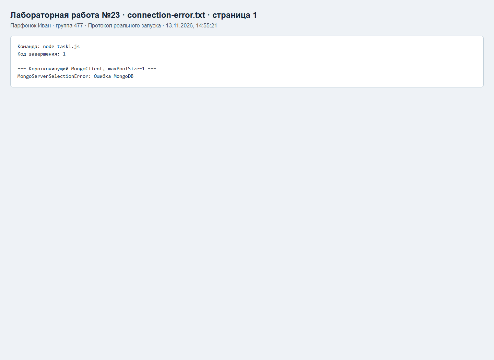
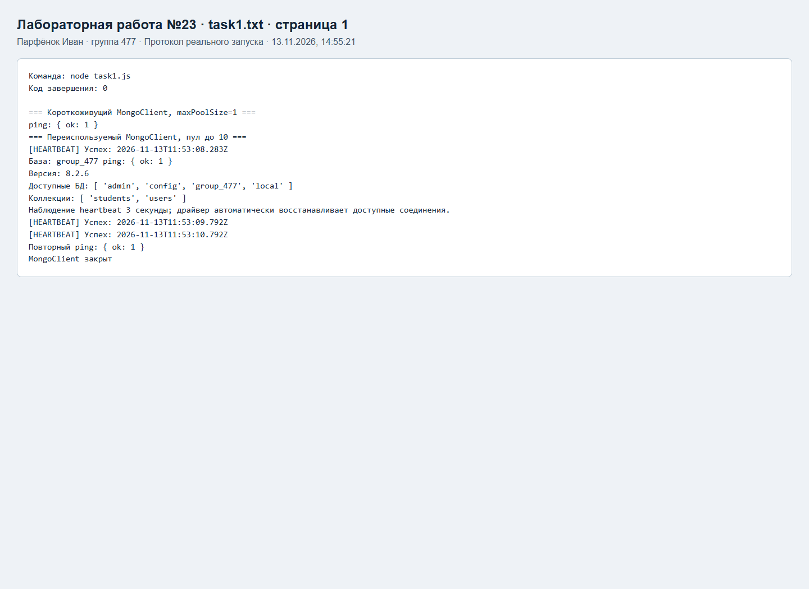
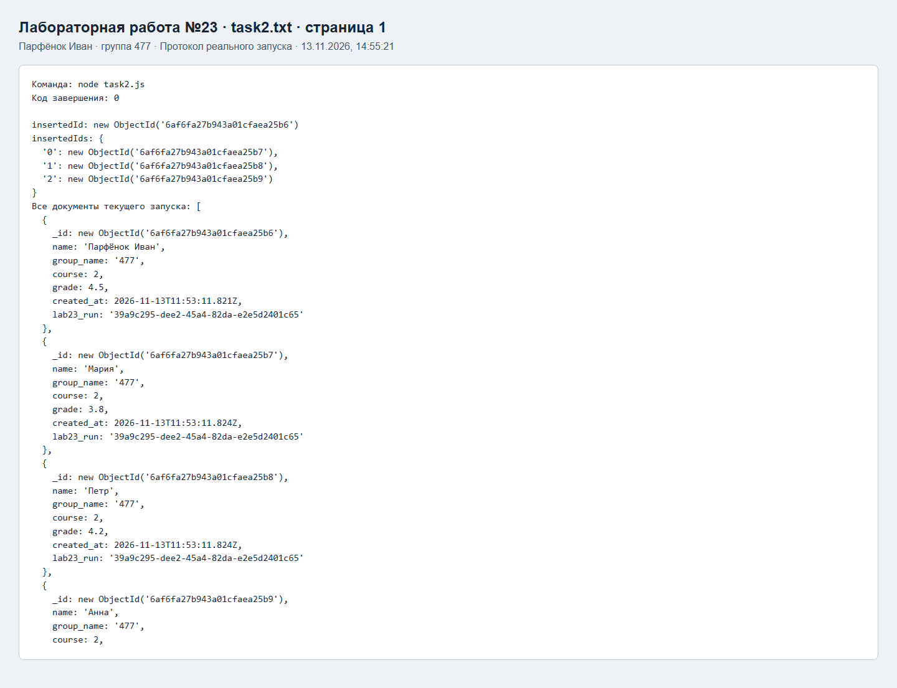
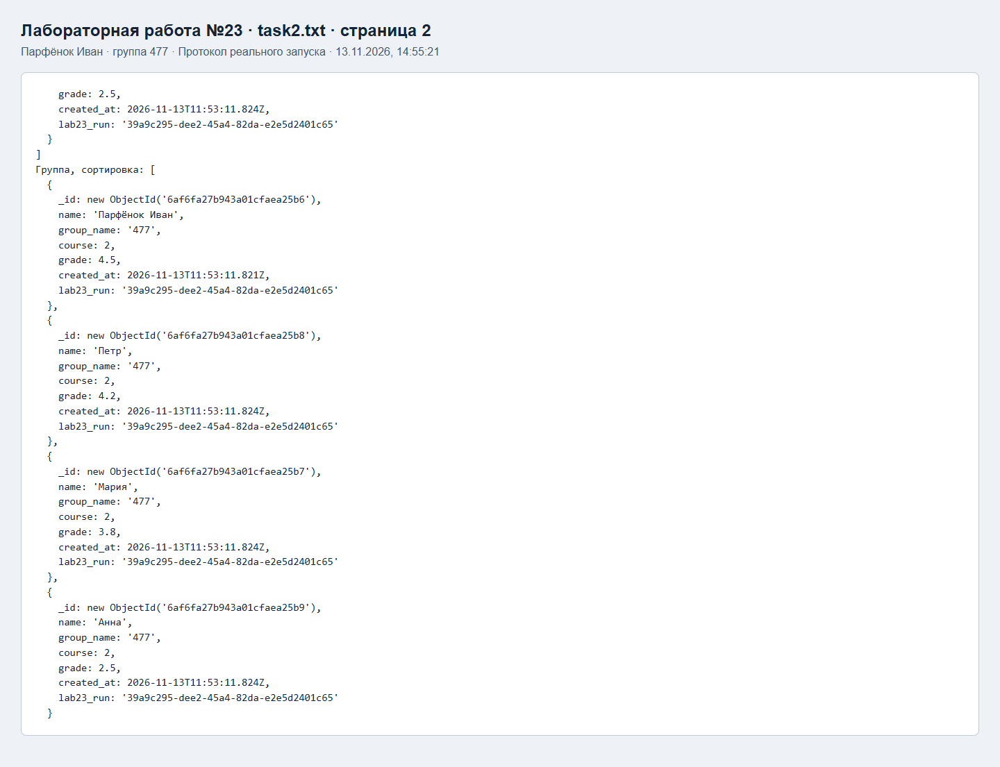
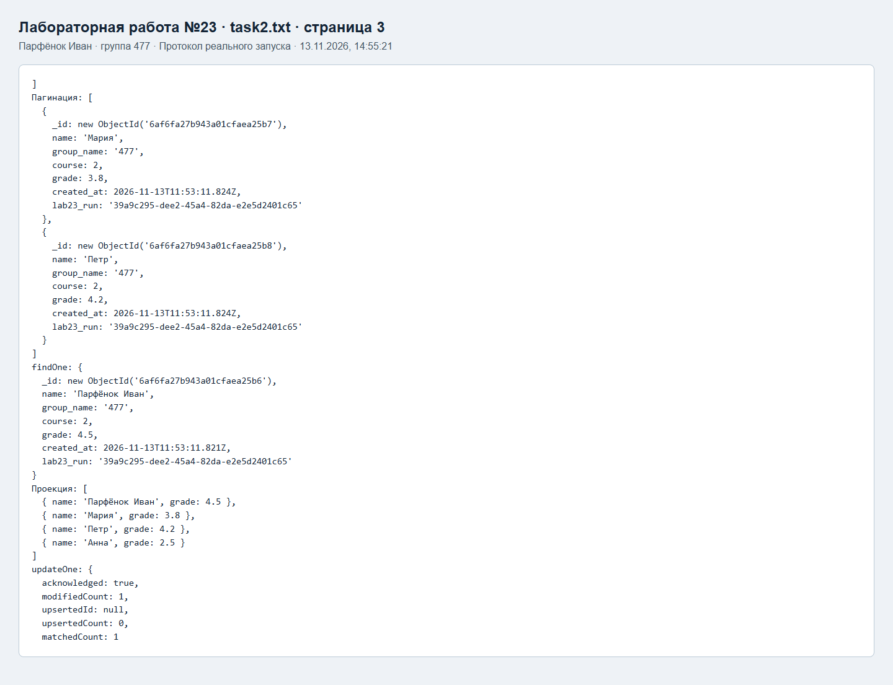
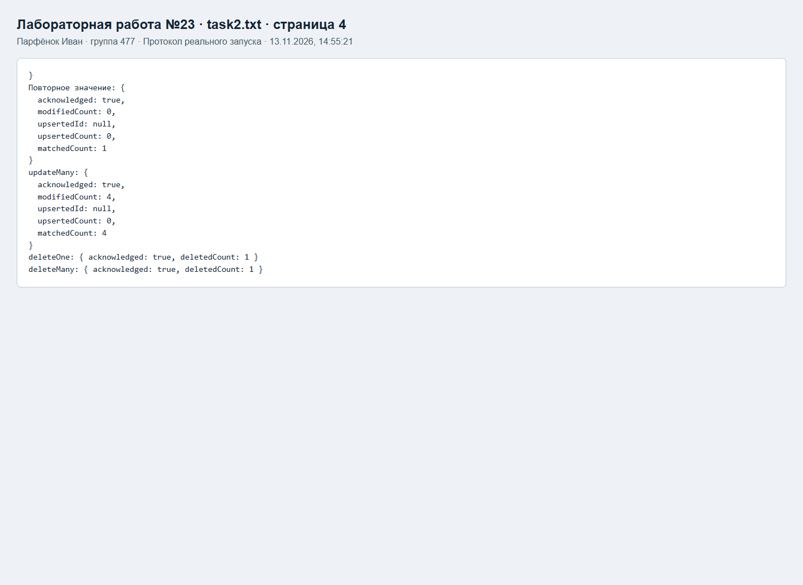
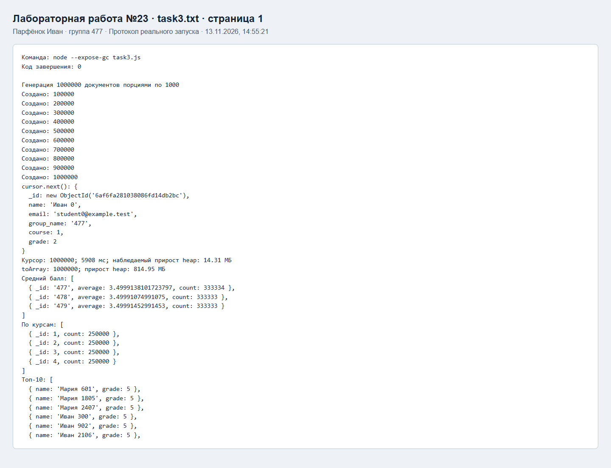
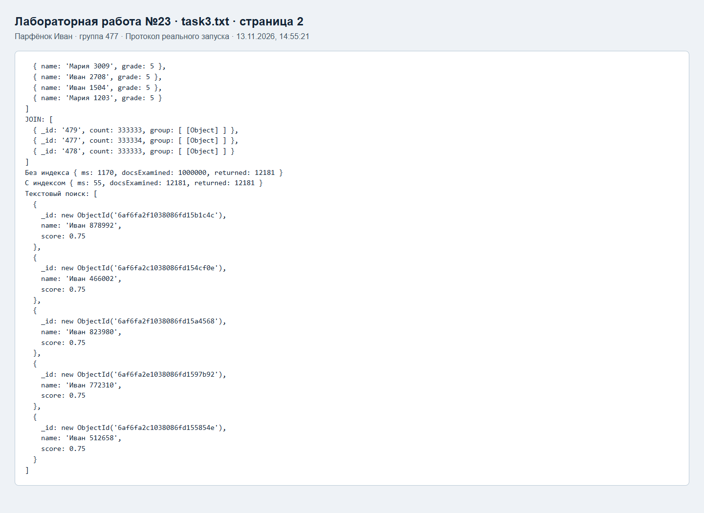

# Проверка лабораторной работы №23

Парфёнок Иван, группа 477, вариант 17.

Снимки ниже показывают HTML-протоколы реальных запусков программ и HTTP-тестов. Это представление сохраненного stdout/stderr, а не снимки окна терминала. Полные журналы доступны рядом в TXT.

## connection-error

[Полный журнал](connection-error.txt)

## task1

[Полный журнал](task1.txt)

## task2

[Полный журнал](task2.txt)

## task3

[Полный журнал](task3.txt)

